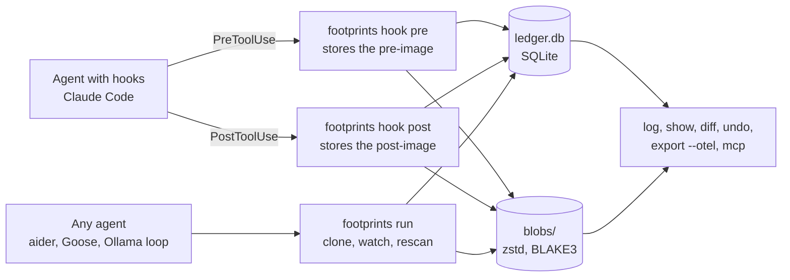

# Footprints

See and undo what AI agents do on your machine.

[](https://github.com/zaccesss/footprints/actions/workflows/ci.yml)
[](LICENSE)

Footprints is a local ledger of what AI agents do: every file they write, create or delete, every
shell command they run and every network call their tools report. Each file change keeps a copy of
the file before and after, so any one step can be shown as a diff and undone. An undo refuses when
the file has changed since the agent touched it, so it never overwrites someone's later work
without being told to.

It works with any agent. The Claude Code hook adapter records the tool and its stated intent. The
`footprints run` wrapper records file changes made by anything it starts, including aider, Goose,
OpenCode and a home-made loop driving a local model through Ollama or llama.cpp.

> [!NOTE]
> Version 0.1 is an early developer CLI. It is built and tested on macOS first and also runs on
> Linux. Windows is not supported yet. See [what can and cannot be undone](#what-can-and-cannot-be-undone)
> before relying on it.

## Contents

- [Quick start](#quick-start)
- [How capture works](#how-capture-works)
- [What can and cannot be undone](#what-can-and-cannot-be-undone)
- [Commands](#commands)
- [Claude Code setup](#claude-code-setup)
- [Any other agent: the wrapper](#any-other-agent-the-wrapper)
- [MCP server](#mcp-server)
- [Data and privacy](#data-and-privacy)
- [Roadmap](#roadmap)
- [Licence](#licence)

## Quick start

Footprints needs Rust 1.89 or later.

```sh
git clone https://github.com/zaccesss/footprints
cd footprints
cargo install --path .
```

Wrap any agent run, then look at what it did and take a step back:

```sh
footprints run --agent aider -- aider
footprints log
footprints diff 3
footprints undo 3
```

What that looks like, with a script standing in for the agent:

```console
$ footprints run --agent demo -- sh agent.sh
footprints: recorded command #1 in session run-5e0c2a91 with 1 file change(s). See `footprints log --session run-5e0c2a91`
$ footprints log
ID  TIME                 AGENT  SESSION       KIND        STATE           TARGET
 1  2026-11-05 09:12:40  demo   run-5e0c2a91  command     not reversible  sh agent.sh
 2  2026-11-05 09:12:40  demo   run-5e0c2a91  file_write  reversible      config.toml (via #1)
$ footprints undo 2
undid #2: restored /Users/me/project/config.toml (recorded as #3)
```

## How capture works

Capture happens in two tiers. A hook knows why something happened: which tool ran and what the
agent said it was for. The wrapper knows what actually changed on disk, whichever process did it.



| Tier | How it captures | What it records | Best for |
| --- | --- | --- | --- |
| Hook adapter | `footprints hook pre` and `footprints hook post` read the agent's hook JSON on standard input | File writes and edits with the tool name. Shell commands with their description as the intent, plus the files each command changed in its working directory. Web fetches and searches as network calls | Claude Code today. Any agent with the same pre and post tool hook shape |
| Wrapper | `footprints run -- <command>` clones the watched directory, watches it while the child runs and rescans afterwards | Every file the child or its subprocesses created, changed or deleted under the watched directory | Any agent, including ones driving a local model |

How the wrapper takes its pre-image:

1. Every file under the watched directory is copied into a staging area inside the data directory.
   On macOS this uses APFS `clonefile`, which shares blocks with the original, so it costs almost
   nothing until a file changes. Other file systems get a plain copy.
2. A file watcher (FSEvents on macOS, inotify on Linux) notes every path touched while the child
   runs.
3. After the child exits, a rescan compares sizes, modification times and the watcher's paths
   against the snapshot. Each real change is confirmed by hash and recorded with both images.

`.git`, `target` and `node_modules` are skipped, since they are rebuilt from source or tracked by
their own tool. Symlinks are recorded but never followed.

The staging path and the list of files are saved in the ledger before the child starts.
`Ctrl+C`, a closed terminal (`SIGHUP`) and a plain `kill` (`SIGTERM`) stop the child but not the
wrapper, which records everything once the child exits. If the wrapper is killed outright with
`SIGKILL`, the next `footprints run` or a `footprints recover` records the changes from the
staging area instead.

Two runs never watch the same or nested directories at once, since each would record the other's
changes. The second one refuses to start and names the run that holds the directory.

## What can and cannot be undone

| Recorded | Undo | Why |
| --- | --- | --- |
| A file write or edit | Restores the pre-image, file mode included | Both images are stored |
| A file the agent created | Deletes it | The pre-image is "did not exist" |
| A file the agent deleted | Recreates it with its contents and mode | The pre-image is stored |
| A shell command | Not as a whole | A command can do anything. The file changes it made inside its working directory are recorded as separate actions under it. Each of those can be undone |
| A network call | Never | The data has already left the machine. It is recorded so it can be seen |
| A file over 32 MiB | Not reversible | Its contents are not stored. The size limit is `FOOTPRINTS_MAX_FILE_BYTES` |
| Changes outside the watched directory | Not recorded | Neither tier sees them in this version |

Further limits worth knowing:

- An undo only goes ahead when the file still matches the recorded post-image. Otherwise it prints
  the conflict and exits with status 3. On the command line `--force` overrides the check, but only
  when the current contents can be stored first. Those contents become the pre-image of the undo,
  so a forced undo can itself be undone. `--force` refuses when the current file is too large to
  store, a directory or a symlink, since overwriting it would destroy it. The MCP server has no
  force option at all.
- The file is checked again just before the restored copy is renamed into place. A change in that
  moment makes the undo stop and leave the file alone.
- `undo --session` simulates the whole session before touching any file. Every step must match
  the disk at that point, every pre-image must be in the blob store and every parent directory
  must be creatable. A file that replaced a directory is removed before anything is restored
  under that path. One problem means nothing changes. Once the real undo starts it is not a
  transaction: if the disk changes underneath it or a write fails, it stops at that step, names
  the step and the path and lists what was already undone. Those steps can be reversed with the
  `footprints undo --session` command it prints.
- Each undo command records its own actions in a new session named `undo-` followed by eight
  characters, so one undo can be reversed without touching any other. Undoing an undo puts the
  original change back and makes it undoable again.
- A Bash hook compares the working directory before and after the command. A file another tool
  writes in that directory at the same moment is attributed to the command.
- The first Bash hook in a directory reads every file there to build its snapshot. Later calls
  only re-read files whose size or modification time changed. A snapshot that would read more
  than 256 MiB of new content or take more than 10 seconds is abandoned, so the agent is never
  held up. That command's file changes are not recorded and its note says so. Each later call
  gets further as the cache fills.
- The wrapper refuses to start when the watched directory holds more than 10,000 files, since a
  partial snapshot could not be trusted. Raise `FOOTPRINTS_MAX_FILES` or pick a narrower `--dir`.
- Only regular files are restored. A symlink that is created, removed, repointed or replaced by a
  file is recorded but marked not reversible, so an undo never deletes what replaced it.
  Directories and extended attributes are not restored. A change to a file's mode alone, such as
  `chmod +x`, is not recorded.
- Files that appear while a skipped or unreadable directory changes (for example
  `mv target build` or `chmod 755 private`) may be moved existing data rather than new files. They
  are recorded as not reversible, so an undo never deletes them.
- Files whose names are not valid UTF-8 are not recorded.
- A pre hook whose tool is then denied leaves a `pending` entry that cannot be undone, since the
  tool never ran.
- A Bash call with `run_in_background` is only partly captured. Its post hook fires once the
  command has started, so only changes made by then are recorded. The command's note says so.

## Commands

| Command | What it does |
| --- | --- |
| `footprints log [--session S] [--agent A] [--kind K] [-n N] [--all] [--json]` | The timeline, oldest first, most recent 50 by default |
| `footprints show <id> [--json]` | Every field of one action, plus the file changes under a command |
| `footprints diff <id>` | A unified diff from the pre-image to the post-image |
| `footprints undo <id> [--force]` | Restores the pre-image or deletes a created file. Refuses on a conflict |
| `footprints undo --session <s> [--force]` | Undoes a whole session in reverse order |
| `footprints recover` | Records the changes of a `footprints run` that was killed before it could |
| `footprints export --otel [--session S] [--agent A] [-o FILE]` | OTLP JSON spans following the OpenTelemetry GenAI conventions |
| `footprints run [--agent A] [--session S] [--dir D] [--intent I] -- <command...>` | Runs a command in `D` (default: the current directory) and records every file change it makes there |
| `footprints hook pre` and `footprints hook post` | The hook adapter. Reads a hook payload on standard input |
| `footprints install claude-code --print` | Prints the Claude Code hook configuration. Writes nothing |
| `footprints mcp` | An MCP server on standard input and output |

Every command takes `--no-color`. Exit statuses: 0 for success, 1 for an error, 2 for a usage error
and 3 for an undo that was refused on purpose. `footprints run` is the exception: once the child
has started it exits with the child's own status, so a 1 or a 3 there may come from the child.
Footprints' own messages always start with `footprints:` on standard error, which tells the two
apart.

The OpenTelemetry export uses one trace per session and one span per action, with
`gen_ai.operation.name` set to `execute_tool` and the tool, agent and session in the matching
`gen_ai.*` attributes. File changes under a command are child spans of it. The output loads into
any tool that reads OTLP JSON, such as Jaeger or Langfuse.

## Claude Code setup

Print the hook configuration:

```sh
footprints install claude-code --print
```

It prints the same JSON as [`hooks/claude-code/settings.example.json`](hooks/claude-code/settings.example.json):

```json
{
  "hooks": {
    "PreToolUse": [
      {
        "matcher": "Write|Edit|MultiEdit|NotebookEdit|Bash|WebFetch|WebSearch",
        "hooks": [{ "type": "command", "command": "footprints hook pre" }]
      }
    ],
    "PostToolUseFailure": [
      {
        "matcher": "Write|Edit|MultiEdit|NotebookEdit|Bash|WebFetch|WebSearch",
        "hooks": [{ "type": "command", "command": "footprints hook post" }]
      }
    ],
    "PostToolUse": [
      {
        "matcher": "Write|Edit|MultiEdit|NotebookEdit|Bash|WebFetch|WebSearch",
        "hooks": [{ "type": "command", "command": "footprints hook post" }]
      }
    ]
  }
}
```

Claude Code fires `PostToolUse` only when a tool succeeds. A tool that fails after it started,
such as a Bash command that exits non-zero partway through, fires `PostToolUseFailure` instead.
Both go to `footprints hook post`, so a failed call still has its file changes recorded, with the
error in its note.

Merge the `hooks` block into `~/.claude/settings.json` for every project or `.claude/settings.json`
for one. Footprints never edits agent settings itself. `footprints` must be on the `PATH` the agent
sees. A full path to the binary works too.

The hooks always exit with status 0 and print nothing on standard output, so a problem in
Footprints never blocks the agent's tool call. Errors go to standard error. Each action is stored
with the hook's `session_id` and the agent name `claude-code`, which `--agent` changes. Relative
paths are made absolute from the hook's `cwd` and `..` is resolved before anything is stored.

## Any other agent: the wrapper

```sh
footprints run --agent goose -- goose session
footprints run --agent ollama-loop --dir ~/projects/site -- python agent.py
footprints run --agent aider --intent "fix the failing test" -- aider tests/test_api.py
```

The agent name defaults to the program name. Each run gets a new session unless `--session` is
given. The command runs inside the watched directory, which is `--dir` when given. Using the same
`--session` for several runs groups them, so `footprints undo --session`
takes all of them back at once. The child sees `FOOTPRINTS_SESSION` in its environment. Pressing
`Ctrl+C` stops the child but not Footprints, so the changes made up to that point are still
recorded.

## MCP server

`footprints mcp` is a Model Context Protocol server over standard input and output, so an agent can
read its own ledger and undo its own mistakes. It offers three tools:

| Tool | Arguments | Result |
| --- | --- | --- |
| `footprints_log` | `session`, `agent` and `limit`, all optional | The matching actions as JSON |
| `footprints_diff` | `id` | The unified diff |
| `footprints_undo` | `id` or `session` | What was undone. A conflict comes back as an error result |

An agent can never force an undo through MCP, so it can never overwrite newer work. A tool that
fails returns a result with `isError` set. JSON-RPC errors are kept for bad arguments (`-32602`)
and internal faults (`-32603`).

For an MCP client that takes a JSON server list:

```json
{
  "mcpServers": {
    "footprints": { "command": "footprints", "args": ["mcp"] }
  }
}
```

## Data and privacy

Everything stays on the machine. Nothing is sent anywhere. Footprints creates its files with a
`077` umask. The data directory is set to `0700` when its ledger is first created. `blobs/` and
`staging/` are always `0700`. The ledger and every blob are `0600`, so copies of a private file
are never readable by other accounts.

| Setting | Default | Purpose |
| --- | --- | --- |
| `FOOTPRINTS_HOME` | `~/.local/share/footprints` | The data directory |
| `FOOTPRINTS_MAX_FILE_BYTES` | `33554432` (32 MiB) | Files above this are recorded but not stored |
| `FOOTPRINTS_MAX_FILES` | `10000` | The most files one snapshot walks |
| `FOOTPRINTS_SNAPSHOT_BUDGET_BYTES` | `268435456` (256 MiB) | The most new content one Bash hook snapshot reads |
| `FOOTPRINTS_SNAPSHOT_SECONDS` | `10` | The longest one Bash hook snapshot runs |
| `NO_COLOR` | unset | Any value turns colour off |

The data directory holds two things. `ledger.db` is a SQLite database in WAL mode. `blobs/` keeps
each file image once under its BLAKE3 hash, compressed with zstd, so identical contents across
actions take the space of one copy.

> [!WARNING]
> The blob store keeps copies of every file an agent touched, so a `.env` file or a key that an
> agent edited is in there too. Keep the data directory private to your user account. There is no
> pruning command yet: deleting the data directory removes the whole history.

## Roadmap

- A menu bar app with a readable timeline and an undo button, for people who never open a terminal
- Hook adapters for Cursor and Codex, then Gemini CLI
- An FSEvents daemon on macOS, so changes are recorded for processes nobody wrapped
- Linux capture through fanotify with reflink pre-images
- Windows capture through the USN journal
- A Homebrew formula and signed release binaries
- Pruning and a size budget for the blob store

## Contributing and support

See [CONTRIBUTING.md](CONTRIBUTING.md) for how to propose a change, [SUPPORT.md](SUPPORT.md) for
where to ask for help and [SECURITY.md](SECURITY.md) for reporting a vulnerability. Accessibility of
the CLI output is described in [ACCESSIBILITY.md](ACCESSIBILITY.md).

## Licence

Footprints is licensed under the Apache License 2.0. The full text is in [LICENSE](LICENSE) and the
attribution notice is in [NOTICE](NOTICE). The licence is also published at
[apache.org/licenses/LICENSE-2.0](https://www.apache.org/licenses/LICENSE-2.0).
