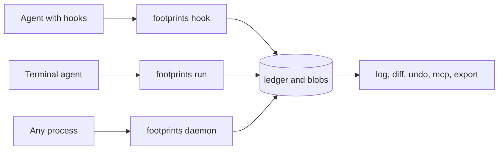

<h1>
  <picture>
    <source media="(prefers-color-scheme: dark)" srcset="assets/footprints-lockup-dark.svg">
    <source media="(prefers-color-scheme: light)" srcset="assets/footprints-lockup-light.svg">
    
  </picture>
</h1>

See and undo what AI agents do on your machine.

[](https://github.com/zaccesss/footprints/actions/workflows/ci.yml)
[](LICENSE)
[](https://crates.io/crates/footprints)
[](https://crates.io/crates/footprints)
[](https://github.com/zaccesss/homebrew-tap/blob/main/Formula/footprints.rb)

Footprints is a local ledger of what AI coding agents do: every file they write, create or
delete, every shell command they run and every network call their tools report. Each file change
keeps a copy of the file before and after, so any one step can be shown as a diff and undone.

<picture>
  <source media="(prefers-color-scheme: dark)" srcset="assets/demo/demo-dark.svg">
  <source media="(prefers-color-scheme: light)" srcset="assets/demo/demo-light.svg">
  
</picture>

The run above is real output, recorded by [`scripts/demo-capture.sh`](scripts/demo-capture.sh).
The same transcript as text is in [`assets/demo/demo.txt`](assets/demo/demo.txt).

## Why it exists

An agent can touch dozens of files in a minute. Version control only sees what was committed.
Footprints records every step as it happens, whichever agent took it, so a bad step can be found
and reversed without losing the good ones around it.

- **Any agent.** Native hooks for Claude Code, Cursor, Codex CLI and Gemini CLI. A wrapper for
  anything started from a terminal. A daemon for anything else.
- **Undo one step or a whole session.** A session undo is simulated in full before any file is
  touched.
- **Never overwrites later work.** An undo refuses when the file changed since the agent touched
  it, unless forced. A forced undo can itself be undone.
- **The agent can check itself.** An MCP server lets an agent read its own ledger and undo its
  own mistakes, with no force option.
- **Local only.** Everything stays on the machine in a private SQLite ledger and blob store.
- **Prune without losing anything by accident.** `footprints prune` removes old history by age,
  session, agent or a size budget. It shows what would go first, keeps every file copy still in
  use and moves the rest to the Trash as an archive that `footprints import` restores.
- **Exportable.** OpenTelemetry GenAI spans for Jaeger, Langfuse or any OTLP tool.



## Supported agents

| Agent | Route | Guide |
| --- | --- | --- |
| Claude Code | Native hooks | [Claude Code](docs/agents/claude-code.md) |
| Cursor | Native hooks | [Cursor](docs/agents/cursor.md) |
| OpenAI Codex CLI | Native hooks | [Codex CLI](docs/agents/codex.md) |
| Gemini CLI | Native hooks | [Gemini CLI](docs/agents/gemini.md) |
| Aider, OpenCode, Amp and the GitHub Copilot CLI | The `run` wrapper, plus MCP where supported | [Aider](docs/agents/aider.md), [OpenCode](docs/agents/opencode.md), [Amp](docs/agents/amp.md), [Copilot](docs/agents/copilot.md) |
| Goose, Cline and Continue | The wrapper for their CLIs or the daemon for their apps, plus MCP | [Goose](docs/agents/goose.md), [Cline](docs/agents/cline.md), [Continue](docs/agents/continue.md) |
| Copilot in VS Code, Windsurf, Devin Desktop and Zed | The daemon, plus MCP | [Copilot](docs/agents/copilot.md), [Windsurf and Devin](docs/agents/windsurf.md), [Zed](docs/agents/zed.md) |
| Local models through Ollama | The route of the agent driving them | [Local models](docs/agents/ollama.md) |
| Anything else | The wrapper or the daemon | [Any other agent](docs/agents/other-agents.md) |

[The agent guides](docs/agents/README.md) say what each route sees and misses.

## Supported platforms

| Platform | Notes |
| --- | --- |
| macOS (arm64 and x86_64) | APFS clones for cheap pre-images. FSEvents for watching |
| Linux (x86_64 and aarch64) | Reflinks on Btrfs, XFS and bcachefs, plain copies elsewhere. inotify, with optional fanotify |
| Windows (x86_64) | Plain copies. ReadDirectoryChangesW, with an optional USN journal reader. Read-only attributes are not restored |

CI tests all three with a real end-to-end run. The menu bar app is macOS only and unsigned.

> [!NOTE]
> Footprints is an early developer CLI. Read [what can and cannot be undone](docs/undo.md#what-can-and-cannot-be-undone)
> before relying on it.

## Install

| Method | Command |
| --- | --- |
| Cargo (Rust 1.89 or later) | `cargo install footprints` |
| Homebrew on macOS and Linux | `brew install zaccesss/tap/footprints` |
| winget on Windows | `winget install zaccesss.Footprints`, once the package is accepted. Its first submission is pending review in the winget repository |
| Release binaries with sha256 sums | From the [GitHub releases](https://github.com/zaccesss/footprints/releases) |
| From source | `git clone https://github.com/zaccesss/footprints && cargo install --path footprints` |

[Getting started](docs/getting-started.md) has the steps for each, Windows included.

## Quick start

Wrap any agent run, then look at what it did and take a step back:

```sh
footprints run --agent aider -- aider
footprints log
footprints diff 2
footprints undo 2
```

What that looks like, with a script standing in for the agent:

```console
$ footprints run --agent demo -- sh agent.sh
footprints: recorded command #1 in session run-bcc287bf with 1 file change(s). See `footprints log --session run-bcc287bf`
$ footprints log
ID  TIME                 AGENT  SESSION       KIND        STATE           TARGET
 1  2026-11-05 12:57:29  demo   run-bcc287bf  command     not reversible  sh agent.sh
 2  2026-11-05 12:57:29  demo   run-bcc287bf  file_write  reversible      config.toml (via #1)
$ footprints undo 2
undid #2: restored /Users/me/demo/config.toml (recorded as #3 in session undo-c41baf35)
```

For an agent with native hooks, print its configuration and merge it into the agent's settings.
Footprints never edits agent settings itself:

```sh
footprints install claude-code --print
```

Every command and flag is in [the command reference](docs/commands.md).

## What it can and cannot undo

| Recorded | Undo |
| --- | --- |
| A file write, create or delete | Yes, mode included, unless the file changed since |
| A shell command | Not as a whole. Each file it changed in its working directory can be undone |
| A network call | Never. It is recorded so it can be seen |
| A file over 32 MiB, a symlink or a directory | Recorded but not reversible |

[Undo](docs/undo.md) has the conflict check, session undo, `--force`, `recover` and the full
table.

## Data and privacy

Everything stays on the machine and nothing is sent anywhere. The ledger and blob store live in
`~/.local/share/footprints` (`%LOCALAPPDATA%\footprints` on Windows) and are private to the user
account. The blob store keeps copies of every file an agent touched, secrets included. Old
history is removed with `footprints prune`, which sends an archive to the Trash rather than
deleting it outright and is never offered to agents over MCP.
[Data and privacy](docs/data-and-privacy.md) has the details.

## Documentation

- [Getting started](docs/getting-started.md): install, a first run and where data lives
- [How capture works](docs/how-capture-works.md): hooks, the wrapper and the daemon
- [Undo](docs/undo.md): every check and every limit
- [Commands](docs/commands.md): every subcommand and flag
- [Agent guides](docs/agents/README.md): setup for every agent
- [MCP server](docs/mcp.md), [OpenTelemetry export](docs/export.md) and [the menu bar app](docs/menu-bar-app.md)
- [Data and privacy](docs/data-and-privacy.md)
- [The full documentation index](docs/README.md)

## Roadmap

What is done, what is next and what is deliberately later is in [ROADMAP.md](ROADMAP.md).

## Contributing and support

See [CONTRIBUTING.md](CONTRIBUTING.md) for how to propose a change, [SUPPORT.md](SUPPORT.md) for
where to ask for help and [SECURITY.md](SECURITY.md) for reporting a vulnerability. Accessibility of
the CLI output is described in [ACCESSIBILITY.md](ACCESSIBILITY.md).

## Licence

Copyright 2026 Isaac Adjei (https://isaacadjei.me)

Footprints is licensed under the Apache License 2.0. The full text is in [LICENSE](LICENSE) and the
attribution notice is in [NOTICE](NOTICE). The licence is also published at
[apache.org/licenses/LICENSE-2.0](https://www.apache.org/licenses/LICENSE-2.0).
