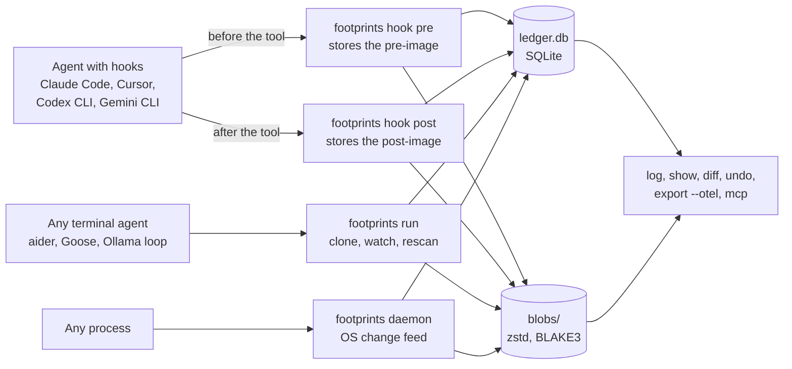

# How capture works

Footprints records agent activity through three capture tiers that write to one ledger. A hook
knows why something happened: which tool ran and what the agent said it was for. The wrapper
knows what actually changed on disk under the folder it watches, whichever process did it. The
daemon sees changes from processes nobody wrapped.

## Contents

- [The three tiers](#the-three-tiers)
- [Hook adapters](#hook-adapters)
- [The wrapper](#the-wrapper)
- [The daemon](#the-daemon)
- [Snapshots and budgets](#snapshots-and-budgets)
- [The ledger and blob store](#the-ledger-and-blob-store)
- [Paths](#paths)
- [What is skipped](#what-is-skipped)

## The three tiers



| Tier | How it captures | What it records | Best for |
| --- | --- | --- | --- |
| Hook adapter | `footprints hook pre` and `footprints hook post` read the agent's hook JSON on standard input | File writes and edits with the tool name. Shell commands with their description as the intent, plus the files each command changed in its working directory. Web fetches and searches as network calls | Claude Code, Cursor, Codex CLI and Gemini CLI. See [the agent guides](agents/README.md) |
| Wrapper | `footprints run -- <command>` clones the watched directory, watches it while the child runs and rescans afterwards | Every file the child or its subprocesses created, changed or deleted under the watched directory | Any agent started from a terminal, including ones driving a local model |
| Daemon | `footprints daemon --root <dir>` follows the operating system's change feed until stopped | Every file any process changed under the roots, as agent `unknown` | Editor extensions, desktop apps and anything outside a hook or wrapper |

The tiers can run together. When two of them see the same change, the daemon joins its record to
the one already made rather than recording it twice (see [the daemon](#the-daemon)).

## Hook adapters

An agent with a hook system runs `footprints hook pre` before a tool call and
`footprints hook post` after it. Each reads the agent's hook payload as JSON on standard input.
`--from` names the agent whose payload format to expect (`claude-code` by default, otherwise
`cursor`, `codex` or `gemini`). `--agent` overrides the agent name stored with each action.

1. The pre hook works out the target from the tool's input: a file path, every path named in an
   `apply_patch` header, a shell command or a URL.
2. For a file, it stores the file's current contents in the blob store as the pre-image and
   leaves a `pending` action. For a shell command, it takes a [snapshot](#snapshots-and-budgets)
   of the command's working directory.
3. The post hook finds that pending action. Claude Code, Cursor's file tools and Codex give a
   call id (`tool_use_id`) that pairs the two. Gemini CLI and Cursor's shell hooks give none, so
   the pair is matched by session, tool and target, with a limit of one minute between them.
4. It stores the post-image and marks the action recorded. For a shell command it compares the
   working directory with the snapshot and records each changed file as its own action under the
   command.

The hooks always exit with status 0, so a problem in Footprints never blocks the agent's tool
call. Errors go to standard error starting with `footprints: hook error:`. That includes a bad
argument in the agent's settings: Footprints reads the payload to the end, prints the reply that
agent expects and exits 0. Cursor and Gemini CLI read the hook's standard output, so their hooks
always print a reply, described in [their guides](agents/README.md). Relative paths are made
absolute from the hook's working directory and `..` is resolved before anything is stored.

A pre hook whose tool call is then denied leaves a `pending` entry that cannot be undone, since
the tool never ran. MCP tool calls are not recorded by any adapter in this version.

## The wrapper

`footprints run` works for any agent that can be started as a command. It takes its pre-image
in three steps:

1. Every file under the watched directory is copied into a staging area inside the data
   directory. On macOS this uses APFS `clonefile` and on Linux a `FICLONE` reflink (Btrfs, XFS
   and bcachefs). Both share blocks with the original, so the copy costs almost nothing until a
   file changes. Other file systems get a plain copy. So does Windows, where ReFS block cloning
   is [deliberately left for later](../ROADMAP.md#deliberately-later).
2. A file watcher (FSEvents on macOS, inotify on Linux, ReadDirectoryChangesW on Windows) notes
   every path touched while the child runs.
3. After the child exits and a short settling delay passes, a rescan compares sizes,
   modification times and the watcher's paths against the snapshot. Each real change is
   confirmed by hash and recorded with both images.

The run is stored as one `command` action with every file change as a child action under it.
The agent name defaults to the program name. Each run gets a new session named `run-` followed
by eight characters unless `--session` is given. Using the same `--session` for several runs
groups them, so one `footprints undo --session` takes all of them back. The child sees
`FOOTPRINTS_SESSION` in its environment. `--intent` stores a sentence about what the run is for
with every action.

### Interrupted runs

The staging path and the list of files are saved in the ledger before the child starts.
`Ctrl+C`, a closed terminal (`SIGHUP`) and a plain `kill` (`SIGTERM`) stop the child but not the
wrapper, which records everything once the child exits. On Windows `Ctrl+C` and `Ctrl+Break`
are handled the same way. When the console window closes, Windows ends the wrapper a few seconds
later whatever it does, so it uses that time to record and stops there.

If the wrapper is killed outright (`SIGKILL`, Task Manager or a console closed mid-record), the
next `footprints run` or a `footprints recover` records the changes from the staging area
instead. A killed wrapper is detected from its process id, with `OpenProcess` on Windows. A
staging area that no pending command refers to is removed once it is an hour old.

### One run per directory

Two runs never watch the same or nested directories at once, since each would record the other's
changes. The second one refuses to start and names the run that holds the directory. A lock file
in `locks/` inside the data directory holds the claim, taken with `LockFileEx` on Windows.

### Exit status

Once the child has started, `footprints run` exits with the child's own status, so a script can
use it in place of the agent. Footprints' own messages always start with `footprints:` on
standard error, which tells them apart from the child's.

## The daemon

```sh
footprints daemon --root ~/projects --root ~/.config --snapshot
```

The daemon records every file change under each root, whichever process made it, until `Ctrl+C`
or `--seconds` runs out. It is opt-in and runs in the foreground. Nothing starts it
automatically. Running it as a launchd agent, a systemd unit or a Windows service is
[left to each user for now](../ROADMAP.md#deliberately-later). Changes are stored as agent
`unknown` in a session named `daemon-` followed by eight characters, under one command entry for
the whole run. Only one daemon records into a data directory at a time.

| Platform | Change feed | With an extra flag |
| --- | --- | --- |
| macOS | FSEvents | None |
| Linux | inotify | `--fanotify` also names the process that closed each written file. It needs `CAP_SYS_ADMIN` (for example `sudo`) and watches the whole mount of each root |
| Windows | ReadDirectoryChangesW | `--usn` also reads the NTFS USN change journal of each root's drive, which keeps every change even when the notification buffer overflows. It works only for roots on lettered NTFS drives and needs an administrator prompt |

fanotify is read for close-after-write events only. inotify supplies creates and deletes.
Reporting those with the process behind them would need `FAN_REPORT_FID` and
`CAP_DAC_READ_SEARCH` as well, which is [left for later](../ROADMAP.md#deliberately-later). The
USN journal is read from the moment the daemon starts, never from before.

### What the daemon can undo

- With `--snapshot`, every file under the roots is copied into the blob store when the daemon
  starts, so the first change to each one is reversible. A root over `FOOTPRINTS_MAX_FILES`
  files is refused rather than half copied. The watcher starts before the snapshot, so a change
  made while the snapshot runs is still seen.
- Without `--snapshot`, the first change the daemon sees to a file has no pre-image and is marked
  not reversible. Later changes to the same file are reversible, because the daemon kept the
  version it saw.
- A new file is undone by deleting it only when the daemon saw it created after it was ready,
  under a snapshot root or at a path it had seen emptied, with a modification time from after
  the daemon started. A move keeps a file's old modification time. That matters because Windows
  reports a file moved in from another folder as added. A move across file systems is also a
  copy on every platform. A file moved in after it was edited during the daemon's run can still
  look new.
- A file moved or renamed in, one that arrived inside a directory moved in one step and one that
  turned up while the snapshot ran may be the only copy of existing data. They are recorded as
  not reversible and an undo never deletes them.

### Lost events

When the change feed loses events (an inotify queue overflow, a full Windows notification buffer
or a watcher error), the daemon walks every root again. It records what changed since it last
looked, deletions included. Files the walk finds that the daemon never knew are recorded as not
reversible.

### Working beside hooks and the wrapper

- A change that a hook, the wrapper or an undo already recorded for the same path, with the same
  result and within ten seconds, is not recorded twice. It is counted as joined to that session.
- Changes under a directory that a running `footprints run` is watching are left to the wrapper.
- A change under the working directory of a shell hook that has not finished is still recorded,
  with a note naming the command, because the call may have been denied.
- Other changes made while an agent session was active say so in their note. That is only a time
  correlation, not proof the agent made them.

## Snapshots and budgets

A shell command can change any file in its working directory, so the Bash hook compares the
directory before and after the command.

- The first Bash hook in a directory reads every file there to build its snapshot. Later calls
  only re-read files whose size, modification time, inode or change time moved, using a file
  cache kept in the ledger. On Windows the inode is the NTFS file index.
- A snapshot that would read more than 256 MiB of new content or take more than 10 seconds is
  abandoned, so the agent is never held up. That command's file changes are not recorded and its
  note says so. Each later call gets further as the cache fills.
- A file another tool writes in that directory at the same moment is attributed to the command.
- A Bash call with `run_in_background` is only partly captured. Its post hook fires once the
  command has started, so only changes made by then are recorded. The command's note says so.

The wrapper refuses to start when the watched directory holds more than 10,000 files, since a
partial snapshot could not be trusted. Raise `FOOTPRINTS_MAX_FILES` or pick a narrower `--dir`.

| Setting | Default | Applies to |
| --- | --- | --- |
| `FOOTPRINTS_MAX_FILE_BYTES` | `33554432` (32 MiB) | Every tier. A larger file is recorded but its contents are not stored, so it is not reversible |
| `FOOTPRINTS_MAX_FILES` | `10000` | The most files one snapshot walks: the wrapper, `daemon --snapshot` and the Bash hook |
| `FOOTPRINTS_SNAPSHOT_BUDGET_BYTES` | `268435456` (256 MiB) | The most new content one Bash hook snapshot reads |
| `FOOTPRINTS_SNAPSHOT_SECONDS` | `10` | The longest one Bash hook snapshot runs |

## The ledger and blob store

Everything lands in the data directory described in [data and privacy](data-and-privacy.md).

- `ledger.db` is a SQLite database in WAL mode. Each row of its `actions` table is one action:
  its time, agent, session, kind, target, tool, call id, intent, note, the hashes, sizes and mode
  of its pre-image and post-image, whether it is reversible, its status and links to its parent
  command and to any undo of it.
- `blobs/` keeps each file image once under its BLAKE3 hash, compressed with zstd, so identical
  contents across actions take the space of one copy.
- `staging/` holds the wrapper's clones while a run is in progress.
- `locks/` holds the claim each running wrapper has on its directory.

Action kinds are `file_write`, `file_create`, `file_delete`, `command` and `network`. States
shown by `footprints log` are `reversible`, `not reversible`, `pending` and `undone`.

## Paths

Paths are stored as absolute paths with `..` resolved. Files whose names are not valid UTF-8 are
not recorded.

On Windows paths are stored with backslashes, an upper-case drive letter, the parent directory
as the file system names it and no trailing dots or spaces. So `c:/work/a.txt.` and
`C:\Work\a.txt` from two agents are the same entry. The `\\?\` prefix is removed. Paths are
otherwise stored as written but compared without regard to case. That comparison folds ASCII
letters only.

## What is skipped

- `.git`, `target` and `node_modules` are skipped by every tier, since they are rebuilt from
  source or tracked by their own tool. The data directory itself is always skipped.
- Symlinks are recorded but never followed.
- Changes outside the watched directory or roots are not recorded by the wrapper or the daemon.
  A hook still records a file tool's own target wherever it is.
- A change to a file's mode alone, such as `chmod +x`, is not recorded.

The consequences for undo are in [what can and cannot be undone](undo.md#what-can-and-cannot-be-undone).
