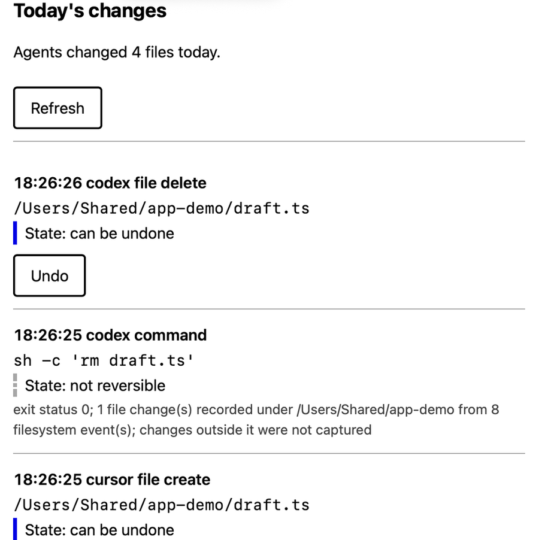

# Menu bar app

[`app/`](../app/README.md) holds a minimal Tauri 2 tray app for macOS, Windows and Linux. It
shows today's recorded changes newest first, with an undo button on each one that can be undone.
It reads the same ledger as the CLI: `FOOTPRINTS_HOME` when set, otherwise the platform default
(`~/.local/share/footprints` on macOS and Linux, `%LOCALAPPDATA%\footprints` on Windows).



## What it does

- Lists today's actions, read from the newest 5,000 in the ledger.
- Undoes one with the same library function as `footprints undo`, so the conflict check is
  identical. When the file changed since it was recorded, the app shows the conflict and leaves
  the file alone.
- Lists each undo as its own entry, marked as the undo of the original change, with a "Take back
  this undo" button. Pressing it puts the agent's change back, so a mistaken click can be
  reversed without a terminal.

There is no force option. `footprints undo <id> --force` in a terminal does that, with the
limits described in [forcing an undo](undo.md#forcing-an-undo).

## Where the icon lives

| Platform | Where | Clicking the icon |
| --- | --- | --- |
| macOS 11 or later | The menu bar, as a template image drawn in the menu bar's own colour | A click opens the window. A right click opens the menu |
| Windows 10 and 11 | The notification area at the right of the taskbar, often behind the `^` overflow arrow at first | A click opens the window. A right click opens the menu |
| Linux | The panel, through AppIndicator (StatusNotifierItem) | Every click opens the menu. Choose "Show today's changes" for the window |

The menu has "Show today's changes" and "Quit Footprints" on every platform. Closing the window
hides it while the app keeps running in the tray. On Windows and Linux the icon is a colour mark
with a light halo, so it reads on a light or a dark taskbar or panel.

To keep the Windows icon in view, drag it out of the overflow onto the taskbar. Settings,
Personalisation, Taskbar, Other system tray icons does the same.

## A ledger in another folder

An app started from the Dock, the Start menu or a Linux app launcher does not read a shell
profile, so a `FOOTPRINTS_HOME` exported only in `~/.zshrc` or `~/.bashrc` never reaches it. The
app then shows the default ledger, which may be empty. Set the variable where the desktop session
reads it:

| Platform | Where |
| --- | --- |
| macOS | `launchctl setenv FOOTPRINTS_HOME /path/to/ledger`, then quit and reopen the app. It lasts until the next restart |
| Windows | `setx FOOTPRINTS_HOME C:\path\to\ledger` in a terminal, then sign out and in |
| Linux with systemd | A line `FOOTPRINTS_HOME=/path/to/ledger` in `~/.config/environment.d/footprints.conf`, then log out and in |

The footer of the window names the ledger folder in use, so a mismatch shows at a glance.

## Install a release

From 0.4.0 every [release](https://github.com/zaccesss/footprints/releases) carries the app
beside the CLI archives, each with a `.sha256` file:

| Platform | File | Built on |
| --- | --- | --- |
| macOS (Apple silicon and Intel) | `footprints-app-vX.Y.Z-macos-universal.zip` holding `Footprints.app` | macOS, one universal binary |
| Windows x86_64 | `footprints-app-vX.Y.Z-windows-x86_64-setup.exe`, an NSIS installer | Windows |
| Linux x86_64 | `footprints-app-vX.Y.Z-linux-x86_64.deb` and `footprints-app-vX.Y.Z-linux-x86_64.AppImage` | Ubuntu 22.04, so older distributions can run them |

Check a download against its sum before opening it:

```sh
shasum -a 256 -c footprints-app-vX.Y.Z-macos-universal.zip.sha256   # macOS
sha256sum -c footprints-app-vX.Y.Z-linux-x86_64.deb.sha256           # Linux
```

```powershell
# Windows: compare the hash with the first word of the .sha256 file
Get-FileHash .\footprints-app-vX.Y.Z-windows-x86_64-setup.exe -Algorithm SHA256
Get-Content .\footprints-app-vX.Y.Z-windows-x86_64-setup.exe.sha256
```

> [!IMPORTANT]
> The app is unsigned on every platform. It has no Apple Developer ID signature and is not
> notarised. The Windows installer has no Authenticode signature. Signing needs paid certificates
> the project does not have yet, so the operating system warns the first time, as described
> below. A signed build is [on the roadmap](../ROADMAP.md#next). Building from source avoids the
> warnings.

### macOS

1. Unzip the file and move `Footprints.app` to `/Applications`.
2. Open it. Gatekeeper refuses the first time with a message that Apple could not verify the app
   is free of malware. The bundle carries an ad hoc signature only, which keeps the system from
   calling it damaged.
3. Open System Settings, then Privacy & Security, scroll to the message about Footprints and
   choose Open Anyway. Confirm with your password or Touch ID.

Removing the quarantine flag in Terminal does the same:

```sh
xattr -dr com.apple.quarantine /Applications/Footprints.app
```

### Windows

1. Run `footprints-app-vX.Y.Z-windows-x86_64-setup.exe`.
2. Microsoft Defender SmartScreen shows "Windows protected your PC", since the installer is
   unsigned and new. Choose More info, then Run anyway.
3. Accept the User Account Control prompt. The installer puts the app in
   `C:\Program Files\Footprints`. It installs for all users on purpose: a per-user install would
   land in `%LOCALAPPDATA%\Footprints`, which Windows treats as the same folder as the ledger in
   `%LOCALAPPDATA%\footprints`.

The window is drawn by the Microsoft Edge WebView2 runtime. Windows 11 and current Windows 10
already have it. When it is missing the installer downloads it. The uninstaller in Settings,
Apps removes the app and leaves the ledger alone.

### Linux

The `.deb` suits Debian, Ubuntu and their derivatives. apt pulls in `libwebkit2gtk-4.1-0`,
`libgtk-3-0` and `libayatana-appindicator3-1`:

```sh
sudo apt install ./footprints-app-vX.Y.Z-linux-x86_64.deb
footprints-app
```

The AppImage runs on most other distributions without installing. It needs FUSE 2, packaged as
`libfuse2` (`libfuse2t64` on Ubuntu 24.04 and later):

```sh
chmod +x footprints-app-vX.Y.Z-linux-x86_64.AppImage
./footprints-app-vX.Y.Z-linux-x86_64.AppImage
```

Without FUSE, add `--appimage-extract-and-run` to that last line. There is no aarch64 Linux
build yet. Build from source on an arm64 machine.

The icon needs a panel that shows AppIndicator icons:

| Desktop | What to do |
| --- | --- |
| GNOME on Ubuntu | Nothing. Ubuntu ships the Ubuntu AppIndicators extension turned on |
| GNOME elsewhere (Fedora, Debian, Arch) | Install the AppIndicator extension (`gnome-shell-extension-appindicator` on Fedora and Debian), log out and in, then turn it on in the Extensions app |
| KDE Plasma, Xfce, Cinnamon, MATE and Budgie | Nothing. They show AppIndicator icons natively |

Without one the app still runs, but no icon appears and there is no way to open the window.

## Start it at login

| Platform | How |
| --- | --- |
| macOS | System Settings, General, Login Items & Extensions. Under Open at Login choose `+` and pick Footprints in Applications |
| Windows | Press `Win+R`, type `shell:startup` and press `Enter`. Drag the Footprints entry from the Start menu into that folder, which leaves a shortcut there |
| Linux with the `.deb` | Copy the desktop entry into the autostart folder, as below |
| Linux with the AppImage | Write a desktop entry in the autostart folder that runs the AppImage by its full path, as below |

```sh
# Linux, .deb install
mkdir -p ~/.config/autostart
cp /usr/share/applications/Footprints.desktop ~/.config/autostart/
```

```sh
# Linux, AppImage kept in ~/Applications
mkdir -p ~/.config/autostart
cat > ~/.config/autostart/footprints.desktop << EOF
[Desktop Entry]
Type=Application
Name=Footprints
Exec=$HOME/Applications/footprints-app-vX.Y.Z-linux-x86_64.AppImage
EOF
```

GNOME Tweaks and the KDE System Settings page Autostart offer the same through a window.

## Build from source

The app is a separate crate with its own workspace and lock file, so `cargo test` at the root of
the repository never compiles Tauri. Every platform needs Rust 1.89 or later, plus:

| Platform | Also needs |
| --- | --- |
| macOS | The Xcode command line tools (`xcode-select --install`) |
| Windows | The Visual Studio C++ build tools and the WebView2 runtime |
| Linux (Debian or Ubuntu) | `sudo apt install build-essential pkg-config libwebkit2gtk-4.1-dev libayatana-appindicator3-dev librsvg2-dev libxdo-dev` |

On Linux distributions without Ayatana, `libappindicator3` works in its place. Fedora calls the
packages `webkit2gtk4.1-devel`, `libappindicator-gtk3-devel`, `librsvg2-devel` and
`libxdo-devel`.

```sh
cargo build --manifest-path app/src-tauri/Cargo.toml --release
./app/src-tauri/target/release/footprints-app
```

A bundle for the current platform (`.app`, the NSIS installer or the `.deb` and AppImage) needs
the Tauri CLI. The release workflow runs the prebuilt npm package at an exact version:

```sh
cd app/src-tauri
npx --yes @tauri-apps/cli@2.11.5 build -- --locked
```

`cargo install tauri-cli --version "^2" --locked` then `cargo tauri build` does the same without
Node.js, after a longer first install.

## Accessibility

The window uses the system's own colours, writes each entry's state in words and gives every
button a 44 by 44 pixel target with a screen reader label. The full list is in
[ACCESSIBILITY.md](../ACCESSIBILITY.md#the-menu-bar-app).

## Linux and GTK 3

> [!WARNING]
> On Linux, Tauri draws the window with WebKitGTK and the tray with AppIndicator, both through
> the GTK 3 Rust bindings (gtk-rs 0.18 with glib 0.18). Those bindings are no longer maintained,
> since gtk-rs has moved to GTK 4. glib 0.18 carries the advisory
> [GHSA-wrw7-89jp-8q8g](https://github.com/advisories/GHSA-wrw7-89jp-8q8g) (RUSTSEC-2024-0429),
> a medium severity unsoundness in `glib::VariantStrIter`. It is fixed only in glib 0.20, which
> Tauri cannot use until it moves to GTK 4. No crate in the app's Linux dependency tree calls
> that iterator. The app's own code never touches GLib directly. Even so, the vulnerable version
> ships inside the Linux `.deb` and AppImage. The macOS and Windows builds do not contain glib
> at all. The dependency goes away when Tauri's Linux backend moves to GTK 4.

## Limits

- It only lists today's actions.
- It shows no diffs. `footprints diff <id>` does.
- On Linux the icon cannot open the window with a single click, since AppIndicator sends no
  click events to the app. The menu's first item does it.
- The releases are unsigned and Linux is built for x86_64 only.
- CI builds, lints and tests it on macOS, Windows and Linux. See the
  [workflow overview](../.github/workflows/README.md).
